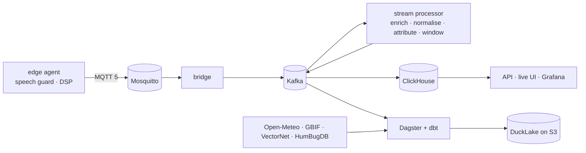

# Wingbeat

[](https://github.com/soheil-mp/wingbeat/actions/workflows/ci.yml)
[](https://soheil-mp.github.io/wingbeat/)
[](LICENSE)

Wingbeat is an open platform for monitoring mosquitoes by their sound, in real time. In the
design, a microphone inside a trap hears the wingbeat tone (roughly 300–800 Hz). A deterministic
signal-processing pipeline on the edge device turns it into a detection with a
temperature-normalised frequency and a ranked set of candidate species. A streaming data
platform then carries every detection to live dashboards, a lakehouse, data-quality gates and
alerts.

> **Status: planning complete, implementation starting.** The research, architecture decisions
> and a 1,032-hour roadmap are in this repository; code lands milestone by milestone. See
> [Status and plans](#status-and-plans).

## Why it's different

- **Explainable by construction.** No machine learning anywhere. Classical estimators
  (harmonic spectra, YIN) and a rule table where every number cites a paper. Each detection
  carries a trace of *why* it was attributed the way it was.
- **Physics-aware.** Wingbeat frequency rises about 9.6 Hz per °C near 500 Hz. A 15 °C daily
  swing moves a tone further than the gap between *Culex pipiens* and *Aedes albopictus*, so
  every detection is normalised to 20 °C with live temperature before attribution
  ([science notes](docs/research/science.md)).
- **Honest about uncertainty.** Bands overlap (26 of 29 species in one study), so Wingbeat
  outputs a *candidate set*, narrowed by which species are recorded in that region (VectorNet,
  GBIF) and by time of day. When the evidence can't decide, it says `ambiguous`.
- **Private by design.** Raw audio never leaves the device. A speech guard runs before anything
  is sent, and only band-limited features go upstream ([ADR-0008](docs/adr/0008-privacy-by-design-audio.md)).
- **Frugal by design.** A physically grounded simulator generates realistic sensor fleets with
  zero storage. Real recordings are pulled clip by clip from a 4.1 GB archive using HTTP range
  requests, capped at 25 MB.
- **Production-grade data engineering.** Protobuf contracts with breaking-change gates, MQTT at
  the edge (on a broker that is, fittingly, called Mosquitto), Kafka in the core, exactly-once
  stream processing, a DuckLake lakehouse modelled with dbt, Dagster orchestration, layered data
  quality, lineage, OpenTelemetry tracing across five hops, signed images and GitOps on
  Kubernetes.

## Who it's for

- **Data and platform engineers** who want a complete, realistic reference for an
  edge-to-lakehouse streaming system that runs on one laptop.
- **Vector-ecology enthusiasts and citizen scientists** who want a low-cost, privacy-respecting
  acoustic sensor and open tooling around it.
- **People learning signal processing** who want tested, documented estimators applied to a real
  problem.

## Built with

| Layer | Tools |
| :-- | :-- |
| Signal processing | Python 3.13, NumPy, SciPy (classical DSP only) |
| Edge and transport | Eclipse Mosquitto (MQTT 5), Apache Kafka 4 (KRaft), Bento bridge, Protobuf + Buf, Apicurio Registry |
| Stream processing | Quix Streams (stateful, exactly-once) |
| Storage | ClickHouse (hot), DuckLake on SeaweedFS S3 with a PostgreSQL catalog (lakehouse) |
| Batch and modelling | Dagster, dbt-core + dbt-duckdb |
| Data quality | dbt tests, Pandera, Dagster asset checks, ODCS data contracts (datacontract-cli), OpenLineage |
| Serving | FastAPI (REST + Server-Sent Events), TypeScript + Vite + MapLibre, Grafana |
| Observability | OpenTelemetry, Prometheus, Loki, Tempo, Grafana |
| Delivery | uv, Ruff, mypy, pytest + Hypothesis, GitHub Actions, Docker (multi-arch), Syft, Cosign, release-please |
| Platform | kind, Helm, Argo CD, Strimzi, CloudNativePG, KEDA, OpenTofu, SOPS |

The reasons for each choice, the versions checked, and the alternatives rejected are in
[`docs/research/technology-landscape.md`](docs/research/technology-landscape.md) and
[`docs/adr/`](docs/adr/).

## How to run it

Prerequisites: [uv](https://docs.astral.sh/uv/) 0.13.6 or newer, `git`, and
[just](https://just.systems) (`uv tool install rust-just`). uv fetches Python 3.13 itself.

```sh
git clone https://github.com/soheil-mp/wingbeat.git
cd wingbeat
just setup   # sync the workspace from uv.lock and install the git hooks
just check   # lint, strict type checks, tests with coverage, every pre-commit hook
just         # list every recipe
```

Prefer containers? Open the repository in a dev container (VS Code, GitHub Codespaces or the
`devcontainer` CLI): `.devcontainer/` installs the same pinned uv, just and buf and runs
`just setup` for you.

Today that runs the workspace skeleton and its quality gates. From milestone M4 on, Docker 24+
is needed as well, and the whole platform starts with one command:

```sh
cp .env.example .env
just demo     # simulator → MQTT → Kafka → stream processor → ClickHouse → Grafana
```

## Architecture



The full container view, delivery guarantees and naming conventions are in
[`docs/architecture.md`](docs/architecture.md).

## Data and privacy

Wingbeat uses synthetic data first, and only openly licensed environmental and biodiversity data
besides: HumBugDB lab recordings (CC BY 4.0), GBIF species counts, VectorNet distribution status
(CC BY 4.0), Open-Meteo weather (CC BY 4.0) and Eurostat GISCO boundaries. No personal data, no
recordings of people and no health records. Licences, size caps and attribution:
[`docs/research/data-sources.md`](docs/research/data-sources.md).

## Status and plans

What exists today:

- Literature review, data-source and licence survey, and the stack selection (`docs/research/`)
- Ten architecture decision records (`docs/adr/`) and the target architecture
- Repository tooling: pre-commit with gitleaks, markdownlint and Conventional Commits, plus CI
  with a full-history secret scan
- GitHub milestones for M0–M18, with issues open for M0 and M1
- The species reference table with its JSON Schema (`reference/species.yaml`)
- The first `wingbeat-dsp` estimators: resampling to 8 kHz, DC removal and framing, the
  250–2,500 Hz band-pass and mains-hum notches, Welch PSD with interpolated peaks and spectral
  flatness, harmonic-sum and harmonic-product *f0* with an octave guard, and YIN as a
  cross-check; each with a streaming form where the pipeline needs one, and property tests

What's next: the work ahead is in [`ROADMAP.md`](ROADMAP.md). It has 19 milestones and
1,032 hours of planned work, every item estimated. Next up are the rest of the science
specification (M1) and of the DSP library (M2): noise floor and SNR, event segmentation,
concurrent sources, temperature normalisation and the attribution rule engine. Each milestone's items become
GitHub issues when that milestone starts.

## Documentation

The documentation site is at <https://soheil-mp.github.io/wingbeat/> (built from `docs/` with
`just docs`, and `just docs-serve` for live preview).

## Contributing and security

See [`CONTRIBUTING.md`](CONTRIBUTING.md) and [`SECURITY.md`](SECURITY.md).

## License

MIT, see [`LICENSE`](LICENSE). Third-party data keeps its own licence; see the attribution list in
[`docs/research/data-sources.md`](docs/research/data-sources.md#attribution-text-shown-in-the-ui-and-the-docs-footer).
