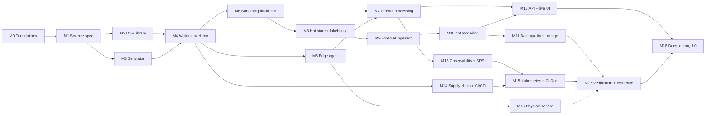

# Wingbeat roadmap

Wingbeat listens for mosquitoes. A microphone in a trap hears a wingbeat tone, a deterministic
signal-processing pipeline on the edge device turns it into a detection with a temperature-
normalised frequency and a ranked set of candidate species, and a streaming data platform carries
it to live dashboards, a lakehouse, data-quality gates and alerts. This roadmap takes the project
from an empty repository to a 1.0 release.

- **Total planned work: 1,032 hours** in 19 milestones (M0–M18), plus 226 hours of optional
  stretch work (S1–S8).
- **Done so far: 61 hours** (see the ticked items below).
- **Pace:** about 12 months at 20 h/week, or 7 months at 35 h/week.

Research behind the plan: [`docs/research/`](docs/research/). Design decisions:
[`docs/adr/`](docs/adr/). Target architecture: [`docs/architecture.md`](docs/architecture.md).

## How to read this roadmap

- Each item has an ID (`M2.6`), a title, an estimate in **focused hours** and a short scope.
  Estimates include tests, docs and review. They are re-estimated at the start of each
  milestone and are expected to be within about ±30 %.
- `[x]` is done, `[ ]` is planned. Each open item becomes a GitHub issue under a GitHub milestone
  of the same name when its milestone is next in line.
- Every milestone ends with **acceptance criteria**. A milestone is done when all of them hold
  and CI is green on `main`.
- Order follows dependencies, not importance. A thin end-to-end slice (M4) comes early so every
  later milestone hardens something that already runs.

## Goals and non-goals

### Goals

1. Real-time acoustic mosquito detection with a measured latency budget (p95 under 2 s from
   device to queryable store).
2. Explainable, deterministic estimators whose parameters come from cited literature.
3. A production-style data platform: contracts, streaming, orchestration, lakehouse modelling,
   layered data quality, lineage, observability, CI/CD, containers, Kubernetes and GitOps.
4. Privacy by design: no raw audio or speech leaves a device, and no personal data anywhere.
5. Frugal by design: the full stack runs on one laptop, with at most 2 GB of data on disk.

### Non-goals

- Machine-learning models of any kind, including training, fine-tuning or serving
  ([ADR-0002](docs/adr/0002-deterministic-signal-processing.md)).
- Human health data, case counts or anything about people.
- User accounts or multi-tenant hosting. The public API and UI are read-only.
- Species *identification* claims beyond what the literature supports. The output is a candidate
  set with an explicit ambiguity flag ([ADR-0009](docs/adr/0009-temperature-normalised-attribution.md)).

## Phase overview

| Phase | Milestones | Hours | Outcome | Release |
| :-- | :-- | --: | :-- | :-- |
| 1. Foundations | M0, M1 | 74 | Tooling, CI, and a machine-checked science specification | v0.1.0 |
| 2. Signal core | M2, M3 | 135 | DSP library and a physically grounded sensor-fleet simulator | — |
| 3. Walking skeleton | M4 | 40 | One command from clean clone to live detections on a dashboard | v0.2.0 |
| 4. Real-time platform | M5, M6, M7 | 183 | Resilient edge agent, contract-governed streams, stateful stream processing | v0.3.0 |
| 5. Lakehouse and batch | M8, M9, M10, M11 | 224 | Hot store, DuckLake lakehouse, Dagster ingestion, dbt models, layered data quality | v0.4.0 |
| 6. Serving and operations | M12, M13 | 112 | Public API, live UI, dashboards as code, SLOs and runbooks | v0.5.0 |
| 7. Platform engineering | M14, M15 | 116 | Signed multi-arch images, full CI/CD, Kubernetes with GitOps and autoscaling | v0.6.0 |
| 8. Real world and proof | M16, M17 | 106 | Physical sensor in the field, and a published verification, load and chaos report | v0.7.0 |
| 9. Release | M18 | 42 | Documentation site, public demo and 1.0 | v1.0.0 |
| | **Total** | **1,032** | | |

---

## Phase 1 — Foundations

### M0 · Foundations and repository engineering — 38 h

**Goal:** a repository where doing the right thing is the easy thing.

- [x] **M0.1** Repository scaffold (1 h): MIT licence, README, `.gitignore`, `.gitattributes`,
  `.editorconfig`, a placeholder-only `.env.example`.
- [x] **M0.2** Commit-time safety net (1 h): pre-commit with gitleaks, file hygiene checks,
  markdownlint, actionlint and Conventional Commit messages.
- [x] **M0.3** Research notes (8 h): literature review, data-source and licence survey,
  verified technology landscape (`docs/research/`).
- [x] **M0.4** Architecture and ADRs (4 h): the ADR process, ten founding ADRs and the target
  architecture.
- [x] **M0.5** Documentation CI (1 h): a workflow running the pre-commit suite and a full-history
  secret scan on every push, and Dependabot for GitHub Actions.
- [x] **M0.6** uv workspace skeleton (3 h): root `pyproject.toml`, the `packages/` and
  `services/` layout with empty typed packages (`py.typed`), Python 3.13 pin, `uv.lock`.
- [x] **M0.7** Shared quality config (2 h): Ruff rules, `mypy --strict`, pytest with coverage
  thresholds, and the matching pre-commit hooks.
- [x] **M0.8** Task runner (2 h): `justfile` with `setup`, `fmt`, `lint`, `test`, `check`,
  `docs`, `up`, `down` and `demo`, matching CI one to one.
- [x] **M0.9** CI pipeline (4 h): per-package jobs with path filters, uv cache, actions pinned
  by SHA, least-privilege `permissions`, concurrency cancellation, required status checks.
- [x] **M0.10** Dependency policy gate (2 h): licence allow-list and a deny-list of ML and
  model-API packages, enforced in CI from the lockfile.
- [ ] **M0.11** Renovate (1.5 h): grouped updates, lockfile maintenance and digest pinning for
  images, replacing Dependabot.
- [x] **M0.12** Docs site skeleton (3 h): MkDocs Material with Mermaid, the ADR index and
  research notes, deployed to GitHub Pages from Actions.
- [x] **M0.13** Dev container (2 h): `devcontainer.json` with uv, just, buf and Docker-in-Docker.
- [x] **M0.14** Repository settings (1 h): merge commits only, delete merged branches, secret
  scanning with push protection, a ruleset that requires CI on `main`.
- [ ] **M0.15** Release automation (1.5 h): release-please config, `CHANGELOG.md`, first tag
  `v0.1.0`.
- [x] **M0.16** Planning in GitHub (1 h): labels, GitHub milestones M0–M18, and issues for the
  next two milestones.

**Acceptance:** `just check` passes on a fresh clone; CI on a pull request finishes in under
10 minutes; the docs site is live; gitleaks finds nothing in the full history.

### M1 · Science specification — 36 h

**Goal:** turn the literature into a versioned, machine-checked reference before writing DSP
code. Every number has a citation, and unknowns stay unknown.

- [x] **M1.1** Reference table schema (3 h): `reference/species.yaml` plus a JSON Schema
  covering species, sex, mean, SD, n, modality, temperature, RH, DOI, table or page, and notes.
  Validated in CI.
- [x] **M1.2** Populate the reference table (5 h): rows from Kim et al. 2021, Rajan et al. 2025,
  Loh et al. 2024 and Villarreal et al. 2017; per-species temperature slopes; convergence bands.
- [ ] **M1.3** Close literature gaps (8 h): look for primary sources for *Culiseta annulata*, the
  *Anopheles maculipennis* complex, *An. claviger*, *An. plumbeus*, *Coquillettidia richiardii*
  and male *Aedes vexans*. Record each one as found (with source) or still unknown.
- [ ] **M1.4** Diel activity windows (3 h): activity periods per genus and species, with
  citations, expressed in solar time (daylight, twilight, night).
- [ ] **M1.5** Algorithm specification (6 h): `docs/design/signal-processing.md` covering frame
  sizes, filters, estimators, thresholds, hysteresis, convergence detection, normalisation,
  attribution scoring, and the explanation-trace schema.
- [ ] **M1.6** Privacy design (4 h): speech-guard specification, threat model and a short data
  protection impact assessment in `docs/design/privacy.md`.
- [ ] **M1.7** Golden signal catalogue (4 h): 30 named synthetic test signals (pure tone,
  harmonic stack, chirp, two insects, convergence pair, mains hum, wind, rain, speech-like,
  silence, clipping) with their expected outputs.
- [ ] **M1.8** Number cross-check (3 h): a script that recomputes every derived number quoted in
  the docs from the reference table and fails CI on drift.

**Acceptance:** the reference table validates in CI; every row cites a DOI; the algorithm spec
names every parameter with its source or rationale; the golden catalogue is reviewed.

---

## Phase 2 — Signal core

### M2 · `wingbeat-dsp` library — 79 h

**Goal:** a typed, tested, benchmarked library of classical estimators with a batch API and a
stateful streaming API.

- [ ] **M2.1** Package and public API (3 h): frame, event and trace dataclasses; a stateful
  streaming `Processor` plus pure batch functions.
- [x] **M2.2** Framing and conditioning (4 h): windowing and overlap, polyphase resampling to
  8 kHz, DC removal.
- [x] **M2.3** Filters (4 h): SOS Butterworth band-pass (250–2,500 Hz) and a mains-hum comb notch
  (50/60 Hz and harmonics).
- [ ] **M2.4** Noise floor and SNR (5 h): per-band noise floor tracking (minimum statistics or
  running percentile) and SNR per frame.
- [x] **M2.5** Spectral estimation (4 h): Welch PSD, parabolic peak interpolation, spectral
  flatness.
- [x] **M2.6** Harmonic estimators (6 h): harmonic-sum and harmonic-product spectra with an
  octave-error guard.
- [ ] **M2.7** YIN cross-check (5 h): time-domain *f0* and an agreement score between estimators.
- [ ] **M2.8** Event segmentation (5 h): hysteresis thresholds, minimum duration, gap merging,
  per-event *f0* track statistics (median, IQR, slope).
- [ ] **M2.9** Concurrent sources (6 h): track up to N simultaneous harmonic series by
  harmonic-set peeling.
- [ ] **M2.10** Harmonic-convergence detector (4 h): emits `convergence` events when two series
  share a harmonic within tolerance.
- [ ] **M2.11** Temperature normalisation (2 h): Saha et al. 2024 Eq. 3 with per-species slope
  overrides from the reference table.
- [ ] **M2.12** Attribution rule engine (8 h): band distance in SDs, harmonic evidence, regional
  and diel filters, ranking, the ambiguity margin, and a full explanation trace.
- [ ] **M2.13** Speech guard (5 h): syllabic-rate envelope modulation plus voiced-pitch checks.
  Guarded frames are dropped and counted.
- [ ] **M2.14** Property-based tests (6 h): Hypothesis tests for *f0* accuracy against SNR,
  invariance to gain, phase and time shift, and monotonic normalisation.
- [ ] **M2.15** Golden-file regression tests (2 h) over the M1.7 catalogue.
- [ ] **M2.16** Benchmarks (3 h): real-time factor and per-frame latency, with a budget gate in CI.
- [ ] **M2.17** Mutation testing and coverage (3 h): mutmut on the estimators (≥ 80 % killed)
  and ≥ 95 % line coverage.
- [ ] **M2.18** Library docs (4 h): API reference and a "how the detector works" tutorial whose
  figures are generated from code.

**Acceptance:** median *f0* error ≤ 2 Hz for single tones at SNR ≥ 10 dB; real-time factor ≥ 50×
on one laptop core; every golden signal gives its expected output; `mypy --strict` is clean.

### M3 · Sensor-fleet simulator — 56 h

**Goal:** a deterministic, physically grounded virtual sensor fleet. It is the main data source,
the load generator and the test oracle, and it costs no storage.

- [ ] **M3.1** Signal synthesiser (4 h): a harmonic stack with a species harmonic profile, *f0*
  jitter and drift, and amplitude envelopes.
- [ ] **M3.2** Flight dynamics (4 h): fly-by Doppler shift, distance attenuation, approach and
  leave envelopes.
- [ ] **M3.3** Multi-insect scenes (3 h), including male–female convergence duets.
- [ ] **M3.4** Noise beds (6 h): pink and brown noise, gusty wind, rain impulses, mains hum,
  synthetic orthopteran stridulation bands, and speech-like signals for guard tests. All noise is
  generated, never recorded.
- [ ] **M3.5** Ecology drivers (6 h): species mix per site from GBIF facets, diel activity curves
  from M1.4, and temperature and wind gating. Every assumption is documented and configurable.
- [ ] **M3.6** Temperature-dependent tones (2 h): the inverse of the normalisation formula,
  driven by site weather.
- [ ] **M3.7** Fleet configuration (3 h): YAML plus pydantic, made-up site coordinates, sensor
  types, seeds.
- [ ] **M3.8** Fault injection (6 h): clock drift and skew, clipping, dead mic, DC offset, packet
  loss, duplicates, reordering, outages, brownouts.
- [ ] **M3.9** Planted-event manifest (2 h): a record of every planted event, used by end-to-end
  assertions.
- [ ] **M3.10** Run modes (4 h): real time, accelerated (×N) and WAV replay, deterministic per
  seed.
- [ ] **M3.11** Output adapters (3 h): in-process frames, raw PCM over a local socket, and a
  capped WAV writer for debugging.
- [ ] **M3.12** CLI and container image (3 h) built with Typer.
- [ ] **M3.13** Simulator tests (4 h): statistical properties of the generated signals,
  determinism, fault rates.
- [ ] **M3.14** Event-level load mode (4 h): emits detection events directly, bypassing audio, to
  drive 1,000 virtual sensors from one laptop.
- [ ] **M3.15** Assumptions page (2 h): every simulator knob, its default and its source.

**Acceptance:** the same seed gives byte-identical output; 1,000 event-level sensors sustain
5,000 events/s on a laptop; the M2 detector finds ≥ 95 % of planted events at SNR ≥ 10 dB.

---

## Phase 3 — Walking skeleton

### M4 · Thin end-to-end slice — 40 h

**Goal:** prove the architecture early. A simulated sensor publishes, and a dashboard shows the
detection seconds later.

- [ ] **M4.1** Compose `core` profile (5 h): Mosquitto, Kafka (KRaft, single node), Apicurio,
  ClickHouse, Grafana, with healthchecks, named volumes and resource limits.
- [ ] **M4.2** First contracts (4 h): `Envelope`, `Detection` and `Telemetry` protobufs, Buf
  config, Python code generation.
- [ ] **M4.3** Minimal edge agent (4 h): simulator source → DSP → MQTT publish.
- [ ] **M4.4** Bridge spike (5 h): Bento MQTT→Kafka against a 100-line custom Python bridge on
  latency, header mapping and operability. Outcome recorded in ADR-0003.
- [ ] **M4.5** Minimal stream processor (4 h): decode, validate, forward to the enriched topic.
- [ ] **M4.6** ClickHouse ingestion (3 h): Kafka engine, materialised view, MergeTree table.
- [ ] **M4.7** Live dashboard (3 h): provisioned Grafana datasource and a "Live detections"
  dashboard.
- [ ] **M4.8** `just demo` (3 h): one command from a clean clone to a live dashboard.
- [ ] **M4.9** End-to-end smoke test in CI (5 h): bring the stack up, run the simulator for
  2 minutes, assert that planted events reach ClickHouse.
- [ ] **M4.10** Latency harness (2 h): event time to ClickHouse visibility, with baseline numbers
  in the docs.
- [ ] **M4.11** Release v0.2.0 (2 h) with a demo GIF of synthetic data in the README.

**Acceptance:** `just demo` takes under 10 minutes on a clean machine; the e2e job is green in
CI; p95 latency is measured and published.

---

## Phase 4 — Real-time platform

### M5 · Production-grade edge agent — 62 h

**Goal:** an agent that keeps working through bad networks, bad clocks and bad microphones, and
never leaks audio.

- [ ] **M5.1** Audio sources (6 h): microphone (sounddevice on ALSA/PortAudio), a WAV-directory
  watcher, an AudioMoth file importer (parses the WAV header metadata), and HumBugDB replay.
- [ ] **M5.2** Real-time loop (5 h): ring buffer, backpressure, overrun detection, CPU budget
  watchdog.
- [ ] **M5.3** Device health telemetry (3 h): RMS, clipping %, DC offset, noise floor, guarded
  frame count, CPU temperature, disk, uptime.
- [ ] **M5.4** Store-and-forward outbox (6 h): SQLite WAL, bounded with a drop policy and metrics,
  exponential backoff with jitter.
- [ ] **M5.5** MQTT 5 session handling (4 h): persistent sessions with expiry, Last Will,
  retained status, `traceparent` in user properties, QoS 1.
- [ ] **M5.6** Event identity (2 h): UUIDv7 event IDs and a per-device monotonic sequence that
  survives restarts.
- [ ] **M5.7** Time quality (3 h): clock-sync status from chrony, a reported skew estimate, and a
  monotonic-to-wall-clock mapping for event time.
- [ ] **M5.8** Remote configuration (4 h): versioned, validated config on a retained topic, hot
  reload, rollback when invalid.
- [ ] **M5.9** Device security (5 h): TLS, per-device credentials, Mosquitto ACL templates, a
  credential rotation runbook.
- [ ] **M5.10** Thermometer support (3 h): BME280 or SHT31 over I²C with a weather fallback and a
  `temp_source` field.
- [ ] **M5.11** Packaging (4 h): multi-arch image, systemd unit, resource limits, graceful drain
  on shutdown.
- [ ] **M5.12** Chaos tests with Toxiproxy (6 h): 10-minute outage, added latency and bandwidth
  caps, asserting zero loss and per-sensor order.
- [ ] **M5.13** Soak test (3 h): a 24-hour run with memory and CPU leak detection.
- [ ] **M5.14** Agent docs and runbook (3 h).
- [ ] **M5.15** Edge performance budget (5 h): measured on Raspberry Pi class hardware, emulated
  with cgroup CPU limits until the hardware exists.

**Acceptance:** zero events lost across a 10-minute broker outage; the agent stays under 25 % of
one Pi 4 core and 150 MB RSS (or the emulated equivalent); a speech-like test signal produces
zero uplinked frames.

### M6 · Streaming backbone and contracts — 50 h

**Goal:** every stream is declared, versioned, documented and tested.

- [ ] **M6.1** Full schema set (6 h): `Detection`, `Convergence`, `Telemetry`, `Status`,
  `Alert`, `SensorRegistry`, `WeatherObservation`, `DeadLetter`. `buf lint` and `buf breaking`
  run in CI.
- [ ] **M6.2** Registry in production mode (4 h): Apicurio on PostgreSQL, schema registration
  from CI, `BACKWARD_TRANSITIVE` compatibility.
- [ ] **M6.3** Topics as code (4 h): declarative partitions, retention, compaction and
  `min.insync.replicas`, applied idempotently and validated in CI.
- [ ] **M6.4** Three-broker profile (3 h): rack awareness and `min.insync.replicas=2` for
  durability tests.
- [ ] **M6.5** Bridge hardening (5 h): idempotent producer, `acks=all`, header mapping
  (`traceparent`, MQTT topic, message ID), DLQ routing, metrics.
- [ ] **M6.6** Broker config as code (4 h): listeners, TLS, ACLs, persistence, in-flight limits,
  and the dynamic-security plugin for provisioning.
- [ ] **M6.7** Provisioning CLI (4 h): create a sensor (registry entry, MQTT credentials,
  config) and revoke it.
- [ ] **M6.8** Contract tests (4 h): producer and consumer compatibility tests from generated
  fixtures.
- [ ] **M6.9** Developer visibility (2 h): Kafbat UI in development, plus `kafka_exporter` for
  consumer lag.
- [ ] **M6.10** Replay tooling (4 h): reprocess a time range into a new consumer group or target,
  with safety checks.
- [ ] **M6.11** Integration tests (5 h) for the bridge and topics with Testcontainers.
- [ ] **M6.12** Event catalogue (5 h): an AsyncAPI 3 document for the MQTT and Kafka channels,
  generated from the protos and rendered in the docs.

**Acceptance:** a deliberately breaking schema change fails CI; topics are reproducible from
code; the AsyncAPI document renders and matches the code.

### M7 · Stream processing — 71 h

**Goal:** stateful, exactly-once enrichment, attribution, windowing and alerting.

- [ ] **M7.1** Application structure (4 h): Quix Streams app, config, exactly-once processing
  guarantee, graceful rebalancing.
- [ ] **M7.2** Validation (5 h): semantic rules (ranges, timestamp skew, sequence gaps) and a
  reason-coded dead-letter queue.
- [ ] **M7.3** Deduplication (3 h) on `event_id` with a TTL state store.
- [ ] **M7.4** Sensor enrichment (4 h): the registry, read from a compacted topic into state,
  adds the site and its NUTS3 code. Coordinates are rounded.
- [ ] **M7.5** Weather enrichment (5 h): a stream-table join to the latest hourly temperature per
  site, with staleness rules.
- [ ] **M7.6** Normalisation and attribution (4 h) through the `wingbeat-dsp` rule engine. Every
  event records its `reference_version`.
- [ ] **M7.7** Event-time windows (8 h): 1-minute tumbling and 15-minute hopping activity counts
  per taxon group, watermarks with a 10-minute grace period, and a side output for late events.
- [ ] **M7.8** Sensor liveness (4 h): missing-heartbeat detection and uptime accounting.
- [ ] **M7.9** Alert rules (8 h): an invasive candidate in a region where VectorNet reports it
  absent; activity spikes by EWMA and CUSUM; silent sensors; clipping and noise-floor anomalies.
  Alerts are deduplicated and have cooldowns.
- [ ] **M7.10** Alert delivery (3 h): a notifier service from the alerts topic to ntfy or a
  webhook, with retries.
- [ ] **M7.11** Recovery tests (5 h): kill the processor mid-batch and assert no duplicates or
  gaps in the output after state recovery.
- [ ] **M7.12** Throughput and latency (6 h): 5,000 events/s, p95 end-to-end under 2 s on a
  laptop, with profiling and tuning.
- [ ] **M7.13** Unit and property tests (5 h) for the stages and the window arithmetic.
- [ ] **M7.14** Horizontal scaling (4 h): several replicas, partition assignment, stateful scaling
  verified.
- [ ] **M7.15** Topology docs (3 h): processing diagram and delivery semantics.

**Acceptance:** exactly-once holds under forced crashes; late events are counted, never silently
dropped; the latency and throughput targets are met and published. Releases v0.3.0.

---

## Phase 5 — Lakehouse and batch

### M8 · Hot store and lakehouse — 62 h

**Goal:** fast queries over recent data, and an open, rebuildable history in a small disk budget.

- [ ] **M8.1** ClickHouse schema and migrations (6 h): detections (`ReplacingMergeTree` on
  `event_id`), telemetry, alerts, late events; codecs, `LowCardinality`, partitioning and
  ordering keys, managed with goose.
- [ ] **M8.2** Rollups (5 h): `AggregatingMergeTree` materialised views for minute and hour
  activity per sensor and taxon, and a sensor dictionary.
- [ ] **M8.3** TTLs and storage monitors (2 h).
- [ ] **M8.4** Object storage (3 h): SeaweedFS S3 with buckets, credentials, lifecycle rules and
  healthchecks.
- [ ] **M8.5** PostgreSQL 18 (3 h): roles and databases for the DuckLake catalog, Dagster and
  Apicurio, with migrations.
- [ ] **M8.6** DuckLake bootstrap (4 h): the catalog on PostgreSQL, data on S3, a shared
  connection resource.
- [ ] **M8.7** Dagster code location (4 h): scaffold with `dg`, resources for S3, DuckLake,
  ClickHouse and Kafka, `dg dev` in the `batch` profile.
- [ ] **M8.8** Exactly-once lake loader (8 h): Kafka → bronze with offsets committed in the same
  DuckLake transaction as the rows; hourly partitions; backfill from offsets.
- [ ] **M8.9** Lake maintenance (4 h): compaction, snapshot expiry, orphan-file cleanup.
- [ ] **M8.10** Schema-evolution drill (5 h): add a field from proto through the registry,
  ClickHouse, DuckLake and dbt with no downtime.
- [ ] **M8.11** Time travel (3 h): rebuild gold as of a past snapshot.
- [ ] **M8.12** Backup and restore (5 h): PostgreSQL dumps, a DuckLake snapshot and a ClickHouse
  backup to SeaweedFS, with a restore drill.
- [ ] **M8.13** Query benchmarks (4 h): ClickHouse p95 under 200 ms for 24-hour queries; a full
  gold rebuild under 5 minutes.
- [ ] **M8.14** Storage budget (2 h): an asset check that fails above 2 GB, and retention docs.
- [ ] **M8.15** Integration tests (4 h) for ClickHouse, PostgreSQL and SeaweedFS with
  Testcontainers.

**Acceptance:** re-running any loader partition changes nothing; a restore drill succeeds; the
benchmarks meet their targets; disk use stays inside the budget.

### M9 · External data ingestion with Dagster — 60 h

**Goal:** every external source is a small, polite, provenance-tracked, tested asset.

- [ ] **M9.1** Shared HTTP client (5 h): retries with backoff, a token-bucket rate limiter per
  API, ETag and If-Modified-Since caching, timeouts, a descriptive user agent. Tested with small
  recorded fixtures.
- [ ] **M9.2** Open-Meteo weather (6 h): hourly, partitioned daily × site, historical backfill,
  48-hour forecast, and the latest values published to `ref.weather` for the stream processor.
- [ ] **M9.3** GBIF species facets (4 h): weekly per country, with a Pandera schema and a drift
  report when the species list changes.
- [ ] **M9.4** VectorNet status (6 h): a sensor on new versions (EML `pubDate`), Darwin Core
  Archive parsing, Culicidae only, person-identifier columns dropped, NUTS mapping.
- [ ] **M9.5** NUTS 2024 boundaries (4 h): GISCO download, DuckDB spatial point-in-polygon for
  site → NUTS3, the attribution text confirmed.
- [ ] **M9.6** Range-request clip reader (8 h): reads the HumBugDB zip central directory over HTTP
  `Range`, selects clips by policy, fetches single entries, verifies CRC and SHA-256, enforces
  the 25 MB cap, writes the licence ledger.
- [ ] **M9.7** Sensor registry (4 h): `config/sensors.yaml` → PostgreSQL → compacted Kafka topic,
  with history through a dbt snapshot.
- [ ] **M9.8** Reference-table publishing (3 h): each species-table version goes to the lake and
  is hot-reloaded by the processors.
- [ ] **M9.9** Scheduling (4 h): partitions, schedules, sensors, concurrency pools (Open-Meteo at
  most 600 calls per minute), retry policies, run tags.
- [ ] **M9.10** Freshness (3 h): a freshness policy per asset and alerts on misses.
- [ ] **M9.11** Backfill drill (3 h): 90 days of weather for every site within the rate limits,
  idempotency verified.
- [ ] **M9.12** Provenance ledger (4 h): source URL, licence, retrieval time, checksum and bytes
  for every materialisation.
- [ ] **M9.13** Tests (6 h): asset unit tests with mocked resources, plus nightly integration
  tests against the live APIs behind a flag.

**Acceptance:** every source has a blocking asset check, a freshness policy, a size cap and a
ledger entry; a full refresh downloads under 50 MB.

### M10 · Modelling with dbt — 52 h

**Goal:** a documented, contract-enforced medallion model on DuckLake.

- [ ] **M10.1** dbt project (4 h): dbt-duckdb attached to DuckLake, profiles from the
  environment, sqlfluff lint.
- [ ] **M10.2** Sources and staging (6 h): source freshness plus staging models for detections,
  telemetry, alerts, weather, the species reference, VectorNet and GBIF.
- [ ] **M10.3** Snapshots (3 h): an SCD2 sensor dimension and reference-table versions.
- [ ] **M10.4** Dimensions (5 h): `dim_sensor`, `dim_site` (with NUTS3), `dim_taxon`,
  `dim_date`, and `dim_time_of_day` from solar elevation (daylight, twilight, night).
- [ ] **M10.5** Facts (6 h): `fct_detection` (incremental with a unique key),
  `fct_activity_hourly`, `fct_sensor_uptime_daily`, `fct_alert`.
- [ ] **M10.6** Marts (6 h): `mart_invasive_watchlist`, `mart_frequency_vs_temperature` (raw
  against normalised distributions), `mart_species_diel_profile`, `mart_data_completeness`.
- [ ] **M10.7** Model contracts (3 h): enforced types and constraints on every mart, with
  versioned models.
- [ ] **M10.8** Tests (5 h): generic and singular tests, and dbt unit tests for the edge cases of
  normalisation and attribution SQL.
- [ ] **M10.9** Exposures and docs (3 h): exposures for the dashboards, API and public demo, plus
  column descriptions.
- [ ] **M10.10** Dagster integration (4 h): one asset per model, partition mapping, dbt tests
  surfaced as asset checks.
- [ ] **M10.11** dbt in CI (4 h): `dbt build` against a seeded synthetic DuckLake, with slim CI on
  `state:modified`.
- [ ] **M10.12** Published dbt docs (3 h) inside the docs site.

**Acceptance:** `dbt build` is green in CI; every mart has a contract and tests; the docs show
column-level descriptions for every gold model.

### M11 · Data quality, contracts and lineage — 50 h

**Goal:** quality checked at each layer, contracts that execute, and lineage you can see.

- [ ] **M11.1** Data-quality strategy (3 h): checks per layer (edge, stream, bronze, silver,
  gold), severity levels and owners.
- [ ] **M11.2** ODCS v3 contracts (6 h) for every published topic and table, run with
  `datacontract test` in CI against DuckDB and ClickHouse.
- [ ] **M11.3** Contract change review (3 h): pull requests fail on breaking contract diffs.
- [ ] **M11.4** Pandera schemas (4 h) at every Python dataframe boundary in Dagster assets.
- [ ] **M11.5** Asset checks (6 h): freshness, volume against a trailing 14-day baseline
  (z-score), null rates, accepted ranges, referential integrity.
- [ ] **M11.6** Cross-store reconciliation (5 h): per-hour counts across Kafka offsets,
  ClickHouse and DuckLake, failing on drift over 0.1 %.
- [ ] **M11.7** Stream quality metrics (4 h): DLQ rate by reason, late-event rate, sequence-gap
  rate and clock-skew distribution in Prometheus.
- [ ] **M11.8** DLQ triage CLI (5 h): inspect, group by reason, fix and replay, with an audit log.
- [ ] **M11.9** Data-quality dashboard and SLOs (4 h): completeness ≥ 99.5 %, hot freshness
  ≤ 5 minutes, lake freshness ≤ 2 hours.
- [ ] **M11.10** Lineage (5 h): OpenLineage events from Dagster and dbt, with Marquez as an
  optional viewer in the `obs` profile.
- [ ] **M11.11** Data incident playbook (2 h): quarantine a partition, backfill, notify.
- [ ] **M11.12** Data catalogue page (3 h): owner, contract, freshness, licence and lineage link
  for every dataset.

**Acceptance:** a corrupted test partition is caught, quarantined and repaired by following the
playbook; contracts run in CI; the reconciliation check is green for a 24-hour run. Releases
v0.4.0.

---

## Phase 6 — Serving and operations

### M12 · API and live UI — 66 h

**Goal:** a fast, documented, read-only public interface, and a UI that explains every
detection.

- [ ] **M12.1** API skeleton (4 h): FastAPI with settings, structured logging, OpenTelemetry,
  health and readiness probes, and RFC 9457 problem details.
- [ ] **M12.2** Resources (8 h): sensors, detections (cursor pagination and filters), activity
  aggregates, alerts, species reference, watch list.
- [ ] **M12.3** Live stream (6 h): Server-Sent Events for detections and alerts, with in-process
  fan-out from one Kafka consumer, backpressure and heartbeats.
- [ ] **M12.4** OpenAPI 3.1 (3 h): spec checked in, breaking diffs fail CI, versioned under `/v1`.
- [ ] **M12.5** HTTP hygiene (4 h): ETag and Cache-Control, rate limiting, CORS, and the admin
  token for write endpoints.
- [ ] **M12.6** API testing (5 h): Schemathesis property-based tests and a Locust profile
  (p95 under 150 ms at 200 requests/s).
- [ ] **M12.7** Web UI scaffold (4 h): TypeScript in strict mode, Vite, ESLint, Vitest, Playwright.
- [ ] **M12.8** Live map (6 h): MapLibre with OpenStreetMap tiles (attributed), sensor status
  and recent activity.
- [ ] **M12.9** Detection feed with "Why?" (6 h): the explanation trace, bands and citations for
  each detection.
- [ ] **M12.10** Spectral waterfall (6 h) of the uplinked band-limited summaries, drawn with
  Canvas or WebGL.
- [ ] **M12.11** Sensor health and alert timeline (4 h).
- [ ] **M12.12** Accessibility (4 h): WCAG 2.2 AA, keyboard navigation, colour-blind-safe palettes,
  a Lighthouse budget in CI.
- [ ] **M12.13** Grafana dashboards as code (6 h): operations, science (raw against normalised
  *f0*) and fleet health, provisioned from the repo.

**Acceptance:** Schemathesis and Playwright suites are green; the Locust target is met; every
detection in the UI links to a full explanation.

### M13 · Observability and SRE — 46 h

**Goal:** one trace per event across all five hops, SLOs with error budgets, and a runbook for
every alert.

- [ ] **M13.1** Instrumentation (6 h): OpenTelemetry traces, metrics and logs in every service,
  with trace-correlated structlog output.
- [ ] **M13.2** Cross-protocol tracing (5 h): edge → MQTT user properties → Kafka headers →
  processor → ClickHouse insert.
- [ ] **M13.3** Telemetry pipeline (4 h): OTel Collector to Prometheus, Loki and Tempo in the
  `obs` profile.
- [ ] **M13.4** Service dashboards (5 h): RED and USE views, Kafka lag, ClickHouse and PostgreSQL
  exporters.
- [ ] **M13.5** SLOs (6 h): end-to-end latency, freshness, completeness, sensor uptime and API
  availability as recording rules with multi-window burn-rate alerts.
- [ ] **M13.6** Canary mosquito (4 h): a virtual sensor plays a known tone every minute, and an
  alert fires if it isn't detected end to end within 60 s.
- [ ] **M13.7** Alert routing (3 h): Alertmanager to ntfy or a webhook, with silences, inhibition
  and a runbook link on every alert.
- [ ] **M13.8** Runbooks (5 h) for every alert and the main failure modes.
- [ ] **M13.9** Log hygiene (2 h): a test that no payload or audio is ever logged, plus sampling
  and retention.
- [ ] **M13.10** Game day #1 (6 h) on Compose: broker crash, ClickHouse outage, Kafka disk full,
  each with a blameless postmortem.

**Acceptance:** the canary has run for 7 days with SLOs reported; each game-day scenario was
detected by an alert and resolved through its runbook. Releases v0.5.0.

---

## Phase 7 — Platform engineering

### M14 · Containers, supply chain and CI/CD — 44 h

**Goal:** small, signed, attested multi-arch images, and a pipeline you can trust.

- [ ] **M14.1** Production Dockerfiles (6 h): multi-stage uv builds, slim or distroless bases,
  non-root users, read-only root filesystems, healthchecks, OCI labels, hadolint.
- [ ] **M14.2** Multi-arch builds (4 h): amd64 and arm64 with Buildx and caching, and image size
  budgets.
- [ ] **M14.3** Image publishing (3 h): GHCR on release, tagged by semver and SHA, with a
  retention policy.
- [ ] **M14.4** Provenance (5 h): CycloneDX SBOMs from Syft, build-provenance attestations,
  keyless Cosign signatures, verified at deploy time.
- [ ] **M14.5** Pipeline hardening (4 h): least-privilege tokens, OIDC where needed, pinned
  actions, an OpenSSF Scorecard badge.
- [ ] **M14.6** Test pyramid in CI (6 h): unit → integration (Testcontainers) → e2e (Compose) with
  path-based selection, and quarantine for flaky tests.
- [ ] **M14.7** Releases (4 h): release-please PRs, changelog, GitHub Releases with SBOM assets,
  a Zenodo DOI per release, and `CITATION.cff`.
- [ ] **M14.8** Preview environments (5 h): an ephemeral kind cluster per labelled PR that runs
  the e2e suite.
- [ ] **M14.9** Developer experience (3 h): `just` recipes that match CI, and a dev container
  validated in CI.
- [ ] **M14.10** Licence compliance (4 h): third-party notices generated for every release.

**Acceptance:** every released image is signed, attested and has an SBOM; deploys refuse
unsigned images; a release is fully automated from merged Conventional Commits.

### M15 · Kubernetes and GitOps — 72 h

**Goal:** the whole platform declared in Git, reconciled by Argo CD, and scaled on real signals.

- [ ] **M15.1** Cluster bootstrap (5 h): a 3-node kind cluster with ingress and a local registry,
  bootstrapped by OpenTofu through `just k8s-up`.
- [ ] **M15.2** Helm charts (8 h) for our services: a shared library chart, a values JSON
  schema, helm-unittest, chart-testing in CI.
- [ ] **M15.3** Kafka on Strimzi (6 h): KRaft node pools, and `KafkaTopic` and `KafkaUser`
  resources generated from the topics-as-code definitions.
- [ ] **M15.4** PostgreSQL on CloudNativePG (5 h): backups to SeaweedFS; Apicurio and Dagster on
  top.
- [ ] **M15.5** ClickHouse on the Altinity operator (5 h) with ClickHouse Keeper.
- [ ] **M15.6** SeaweedFS and Mosquitto (5 h), with TLS from cert-manager.
- [ ] **M15.7** Dagster on Kubernetes (4 h): the official chart with our code-location image and
  the Kubernetes run launcher.
- [ ] **M15.8** In-cluster observability (4 h): kube-prometheus-stack or the LGTM charts, with
  dashboards provisioned.
- [ ] **M15.9** Argo CD (6 h): app-of-apps, Kustomize overlays (dev, prod-like), sync waves,
  drift detection.
- [ ] **M15.10** Secrets (4 h): SOPS with age (KSOPS) or Sealed Secrets, and no plaintext in Git.
- [ ] **M15.11** Baseline hardening (5 h): Pod Security `restricted`, default-deny network
  policies, requests and limits, PDBs, probes, topology spread.
- [ ] **M15.12** Autoscaling (5 h): HPA for the API, KEDA on consumer lag for the stream
  processors, with a scale test.
- [ ] **M15.13** Upgrade and rollback drills (5 h): a Kafka rolling upgrade and an application
  rollback through Git revert.
- [ ] **M15.14** Platform docs (5 h): runbook, cluster diagram, footprint table.

**Acceptance:** `just k8s-up` gives a fully synced cluster from scratch; a Git revert rolls the
cluster back; KEDA scales the processors under load and back down. Releases v0.6.0.

---

## Phase 8 — Real world and proof

### M16 · Physical sensor and field operation — 56 h

**Goal:** real hardware in the loop, measured honestly. This milestone isn't on the critical
path; everything before it runs on simulated sensors.

- [ ] **M16.1** Bill of materials (2 h): Raspberry Pi 4/5, an I²S MEMS microphone, a temperature
  and humidity sensor, power, with a cost table.
- [ ] **M16.2** Acoustic chamber (8 h): a 3D-printable trap insert designed in CAD (STEP and STL
  in `hardware/`), printable without supports.
- [ ] **M16.3** Audio bring-up (4 h): I²S overlay, gain staging, sample-rate verification.
- [ ] **M16.4** Calibration rig (6 h): a speaker plays simulator tones to measure frequency
  accuracy and the noise floor; a sine sweep measures the chamber's frequency response.
- [ ] **M16.5** Edge OS image (6 h): a provisioning script (cloud-init or Ansible), container
  runtime, chrony, a read-mostly root filesystem.
- [ ] **M16.6** Over-the-air updates (6 h): pull signed images by digest, verify with Cosign,
  health-gated restart with automatic rollback.
- [ ] **M16.7** Field test (8 h): two weeks in a private garden, with an uptime and data-quality
  report and a speech-guard log (counts only).
- [ ] **M16.8** AudioMoth workflow (6 h): configure, deploy, and import the SD dump through the
  offline batch path of the edge pipeline.
- [ ] **M16.9** Power and thermal profile (4 h), with a battery-runtime estimate.
- [ ] **M16.10** Build guide (6 h): wiring diagram, photos (no people), safety notes.

**Acceptance:** the calibration report shows frequency error within the M2 tolerance; the field
test ran for two weeks with published uptime; no raw audio left the device.

### M17 · Verification, performance and resilience — 50 h

**Goal:** a public report that shows what the system can and cannot do.

- [ ] **M17.1** Detection characteristics (6 h): detection probability and false-alarm rate
  against SNR for each golden signal class, from planted synthetic events.
- [ ] **M17.2** Estimator error (4 h): *f0* error against SNR, harmonic content and the number of
  concurrent sources.
- [ ] **M17.3** Temperature study (4 h): band overlap before and after normalisation across
  simulated 10–35 °C diurnal cycles.
- [ ] **M17.4** Real-clip cross-check (5 h): *f0* of HumBugDB lab clips against the literature
  band for each labelled species. Disagreements are documented, never tuned away.
- [ ] **M17.5** Speech-guard verification (3 h): false-pass and false-block rates on synthetic
  speech-like signals.
- [ ] **M17.6** Load test (6 h): 1,000 virtual sensors at 5,000 events/s for one hour, and a
  capacity model per component.
- [ ] **M17.7** Chaos on Kubernetes (8 h): Chaos Mesh broker pod kills, network partitions and
  node drains, with RPO and RTO measured against targets.
- [ ] **M17.8** Disaster recovery (5 h): restore everything from backups plus Kafka replay into a
  fresh cluster.
- [ ] **M17.9** Reproducibility (3 h): fresh clone → `just demo` in under 10 minutes on a clean
  runner, with deterministic outputs for fixed seeds.
- [ ] **M17.10** Verification report (6 h) in the docs, with every plot generated by code.

**Acceptance:** the report is published, reproducible from one command, and states its
limitations next to its results. Releases v0.7.0.

---

## Phase 9 — Release

### M18 · Documentation, demo and 1.0 — 42 h

**Goal:** a project a stranger can understand in five minutes and run in ten.

- [ ] **M18.1** Docs structure (4 h): Diátaxis layout (tutorials, how-to guides, reference,
  explanation).
- [ ] **M18.2** Tutorials (6 h): "Run Wingbeat on your laptop", "Add a virtual sensor fleet",
  "Build a sensor".
- [ ] **M18.3** Reference (4 h): configuration, CLI, API (rendered OpenAPI), events (rendered
  AsyncAPI), contracts, dbt docs.
- [ ] **M18.4** Explanations (6 h): the physics of wingbeats, temperature normalisation,
  candidate-set attribution, the privacy design.
- [ ] **M18.5** Public demo (8 h): a static dashboard on GitHub Pages, rebuilt nightly from gold
  exports with DuckDB-WASM and Observable Plot, and labelled as synthetic data.
- [ ] **M18.6** README polish (2 h): architecture image, demo GIF, badges.
- [ ] **M18.7** Contributor experience (2 h): good-first-issue labels, an updated contributing
  guide, a code of conduct.
- [ ] **M18.8** v1.0.0 (4 h): freeze, upgrade notes, signed images, SBOMs, DOI.
- [ ] **M18.9** Write-up (6 h): an engineering case study and a five-minute demo script.

**Acceptance:** a first-time reader reaches a live local dashboard by following the tutorial
alone; v1.0.0 is tagged, signed and archived with a DOI.

---

## Stretch milestones (not in the total)

| ID | Item | Hours |
| :-- | :-- | --: |
| S1 | Rust DSP core with PyO3 and maturin, benchmarked against NumPy and held to the same golden tests | 40 |
| S2 | In-browser detector: the DSP core compiled to WebAssembly for a "hum test" page that runs entirely on the viewer's device and uploads nothing | 24 |
| S3 | Microcontroller node: ESP32-S3 with an I²S mic, a fixed-point DSP subset, nanopb and MQTT | 60 |
| S4 | Flink SQL alternative for the windowed aggregates, with an operations-cost comparison against Quix Streams | 30 |
| S5 | Iceberg interoperability: gold exported to Iceberg with a REST catalog (Lakekeeper) and queried from Trino | 24 |
| S6 | Kafka tiered storage to S3 for long retention at low disk cost | 16 |
| S7 | Multi-site federation: MQTT bridges between regional brokers, and MirrorMaker 2 | 24 |
| S8 | Tooling trials: migrate the docs to Zensical before Material for MkDocs reaches end of life (5 May 2027), and try `ty` for type checking once it reaches 1.0 | 8 |
| | **Stretch total** | **226** |

---

## Quality targets

| Area | Target | Verified in |
| :-- | :-- | :-- |
| End-to-end latency | p95 < 2 s from device publish to ClickHouse visibility | M4, M7, M13 |
| Freshness | hot ≤ 5 min; lake ≤ 2 h | M11, M13 |
| Completeness | ≥ 99.5 %; zero loss through a 10-minute broker outage | M5, M11 |
| Estimator accuracy | median *f0* error ≤ 2 Hz at SNR ≥ 10 dB (single source) | M2, M17 |
| DSP speed | real-time factor ≥ 50× on one laptop core | M2 |
| Edge footprint | < 25 % of one Pi 4 core, < 150 MB RSS | M5, M16 |
| Throughput | 5,000 events/s sustained on a laptop | M7, M17 |
| API | p95 < 150 ms at 200 requests/s | M12 |
| Tests | ≥ 90 % coverage overall; ≥ 95 % coverage and ≥ 80 % mutation score for `wingbeat-dsp` | M2, M14 |
| CI | pull-request pipeline < 10 min | M0, M14 |
| Onboarding | clean clone → live dashboard < 10 min | M4, M17 |
| Storage | ≤ 2 GB of data on disk | M8 |

## Definition of done (every item)

1. Code, tests and docs land in one pull request, merged with a merge commit after CI is green.
2. Public behaviour changes come with updated docs, `README.md` and this roadmap.
3. Architecture-level changes come with an ADR.
4. New external data comes with a licence, attribution text and size cap in
   `docs/research/data-sources.md`.
5. New environment variables are added to `.env.example` with placeholders.
6. No personal data, raw audio or secrets anywhere, in code, fixtures, logs or history.

## Risk register

| # | Risk | Likelihood | Impact | Mitigation |
| :-- | :-- | :-- | :-- | :-- |
| R1 | Literature has no frequency values for several Dutch species | High | Medium | Mark them unknown; candidate sets widen; M1.3 searches for primary sources |
| R2 | Frequency bands overlap and limit species resolution | Certain | Medium | Temperature normalisation, regional and diel filters, explicit `ambiguous` flag (ADR-0009) |
| R3 | Synthetic data flatters the detector | Medium | High | Real lab clips replayed in every e2e run; the report states where simulation differs (M17) |
| R4 | DuckLake 1.0 or DuckDB 2.0 regressions | Medium | Medium | Exact pins; lake rebuildable from Kafka replay and reference sources |
| R5 | Stack too heavy for one laptop | Medium | Medium | Compose profiles, resource limits, a measured footprint table |
| R6 | Python 3.14 support lags in `dagster-dbt` | Medium | Low | Stay on 3.13; Renovate flags support |
| R7 | Open API terms or limits change (Open-Meteo, GBIF, Zenodo) | Low | Medium | Caching, rate limiting, one adapter per source, provenance ledger |
| R8 | Features leak speech | Low | High | Band-limited, rate-capped summaries; speech guard; schema test against raw-sample fields (ADR-0008) |
| R9 | Hardware delays | Medium | Low | M16 is off the critical path; edge budgets emulated with cgroups |
| R10 | Upstream project health (Marquez, Bento) | Medium | Low | Fallbacks named in the ADRs; OpenLineage events don't depend on the viewer |
| R11 | Scope creep | High | Medium | Stretch work kept apart; roadmap reviewed at the end of every milestone |
| R12 | Single maintainer | Certain | Medium | ADRs, runbooks, automation, reproducible one-command setup |

## Roadmap maintenance

This file is reviewed at the end of every milestone: tick finished items, re-estimate the next
milestone, record new risks, and move finished stretch items into the core list when they are
committed to.
