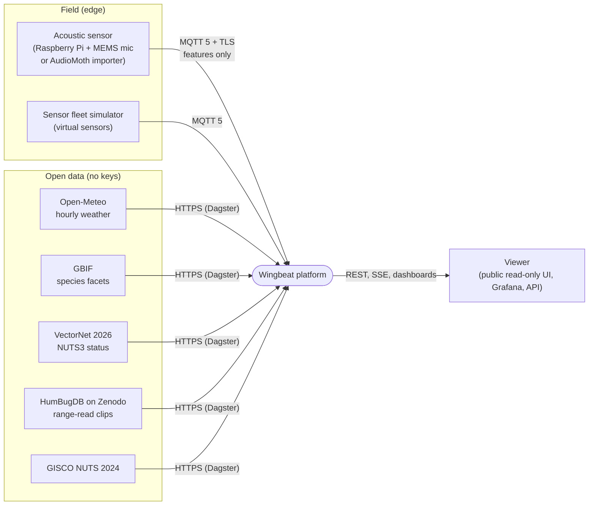
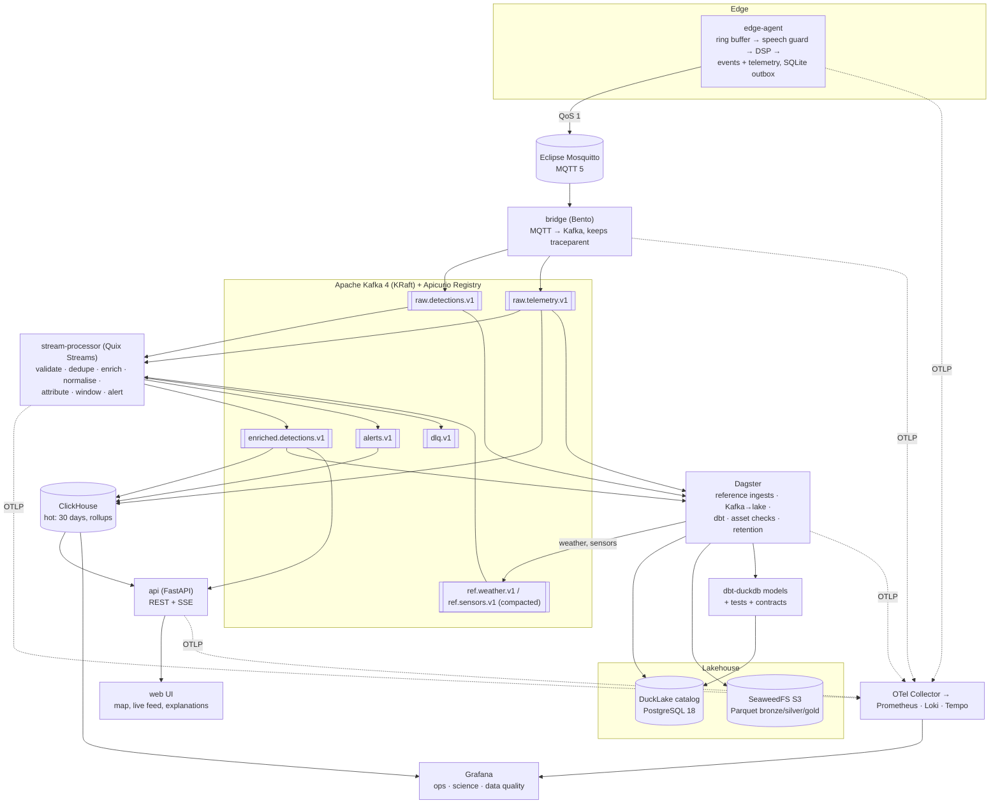

# Architecture

This is the target architecture. `ROADMAP.md` gives the order of construction, and `docs/adr/`
gives the reasons behind each choice.

## 1. System context

## 2. Containers and data flow

## 3. Event lifecycle and guarantees

| Stage | Guarantee | Mechanism |
| :-- | :-- | :-- |
| Device → broker | at-least-once, survives outages | MQTT QoS 1, persistent session, SQLite WAL outbox with bounded size and backoff |
| Broker → Kafka | at-least-once, ordered per sensor | bridge keyed by `sensor_id`, idempotent producer, `acks=all` |
| Kafka → processor → Kafka | exactly-once | Quix Streams transactional processing; dedupe on `event_id` with a TTL state store |
| Kafka → ClickHouse | effectively-once | Kafka engine plus `ReplacingMergeTree` on `event_id` |
| Kafka → lake | exactly-once | offsets committed in the same DuckLake transaction as the rows |
| Late data | accepted up to the grace period | event-time windows with a watermark and a 10-minute grace; later events go to a `late` table, never dropped silently |

Reconciliation: a Dagster asset check compares per-hour counts across Kafka offsets, ClickHouse
and DuckLake and fails on drift over 0.1 %.

## 4. Medallion layers (DuckLake)

| Layer | Content | Built by |
| :-- | :-- | :-- |
| bronze | Raw decoded events and telemetry as received, plus reference snapshots | Dagster Kafka→lake asset (hourly partitions) |
| silver | Validated, deduplicated, typed, enriched (site, NUTS3, temperature), SCD2 sensor dimension | dbt staging and intermediate models, dbt snapshots |
| gold | `fct_detection`, `fct_activity_hourly`, `fct_sensor_uptime_daily`, `mart_invasive_watchlist`, `mart_frequency_vs_temperature`, `mart_data_completeness` | dbt marts with model contracts |

## 5. Topic and naming conventions

- Topics: `wingbeat.<layer>.<entity>.v<major>` (for example `wingbeat.raw.detections.v1`). Key
  is `sensor_id`; 6 partitions in development; retention 24 h, except compacted `ref.*` topics.
- MQTT: `wingbeat/v1/<site_id>/<sensor_id>/{detections|telemetry|status|config}`; `status`
  carries the Last Will, `config` is retained.
- Schemas: `schemas/wingbeat/<domain>/v1/*.proto`, package `wingbeat.<domain>.v1`.

## 6. Deployment views

| View | What runs | Used for |
| :-- | :-- | :-- |
| `compose --profile core` | Mosquitto, Kafka, Apicurio, bridge, stream-processor, ClickHouse, Grafana, simulator | Daily development, walking skeleton |
| `compose --profile batch` | + PostgreSQL, SeaweedFS, Dagster | Reference ingestion, lake, dbt |
| `compose --profile obs` | + OTel Collector, Prometheus, Loki, Tempo | Observability work |
| kind + Argo CD | Everything through Helm charts and operators (Strimzi, CloudNativePG, Altinity) | Platform milestone, GitOps, autoscaling, chaos |
| Raspberry Pi | edge-agent container + systemd unit | Hardware-in-the-loop |
